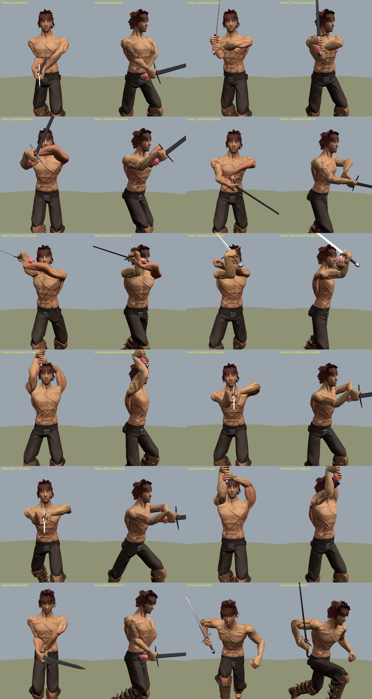
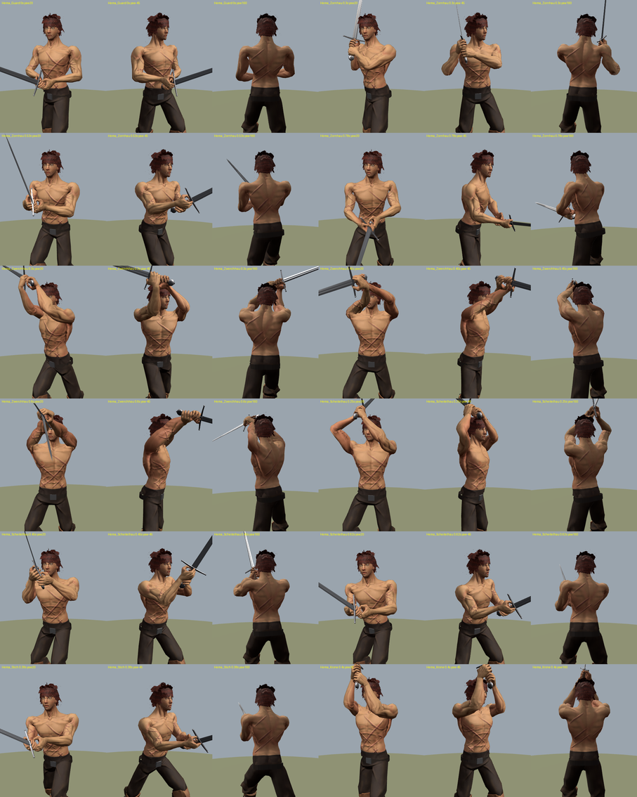
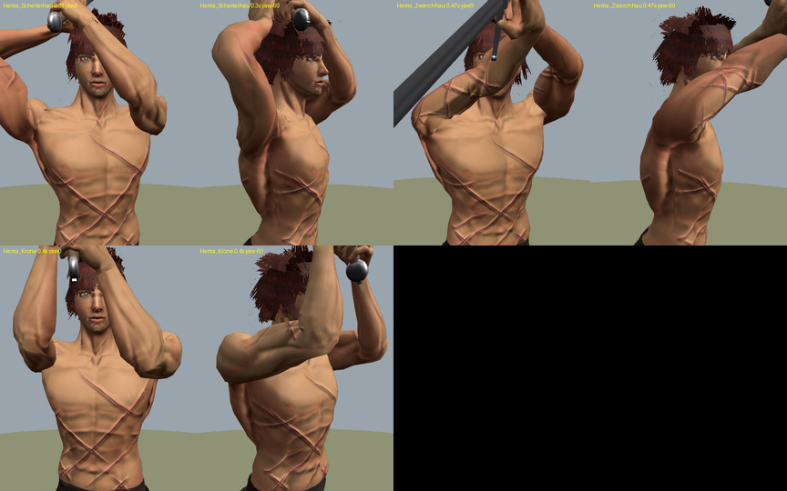
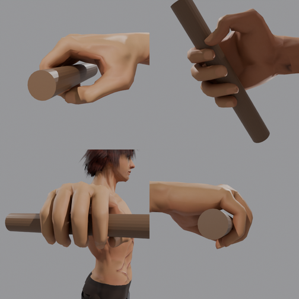
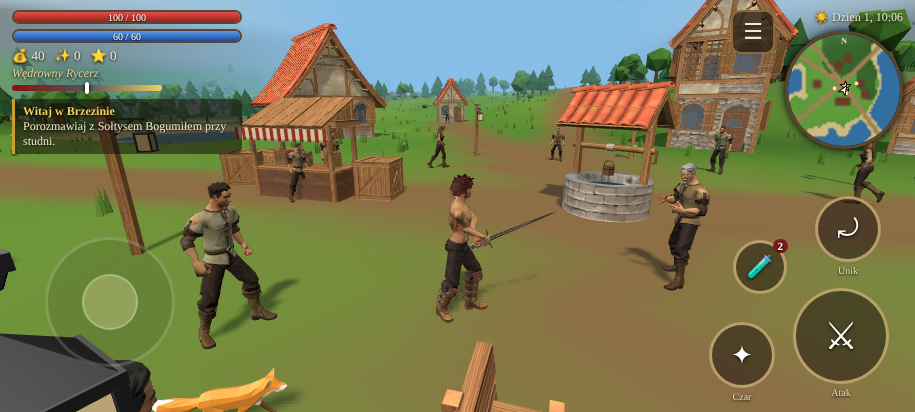
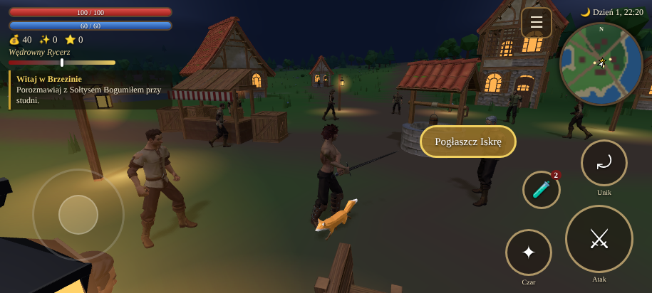
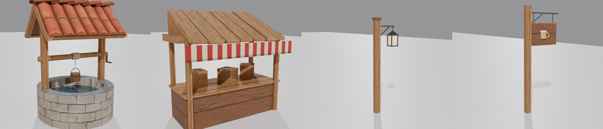

# Kroniki Wrzosu

Oryginalna gra akcji RPG 3D na Androida (fantasy, wybory moralne, otwarty świat).

**Pobierz APK:** [`release/KronikiWrzosu.apk`](release/KronikiWrzosu.apk)

## Co zawiera
- Otwarty świat 3D: wioska Brzezina, Stary Las, obóz bandytów, jezioro, ruiny Starej Strażnicy, dom na wzgórzu
- Cykl dnia i nocy (nocą wychodzą upiory)
- Walka: kombo mieczem, czar błyskawicy, unik, mikstury
- Moralność dobro/zło: aureola albo rogi, inne reakcje mieszkańców, inne zakończenie
- 4 zadania z wyborami, sklep, kupno domu z dochodem, skrzynie ze skarbami
- Rozwój postaci: Siła, Magia, Zręczność (zmieniają wygląd bohatera)
- Lisica Iskra — towarzyszka walcząca u twojego boku
- Automatyczny zapis gry

## Modele 3D i animacje (v1.2–1.4)
**Bohater**
- Realistyczny model z pełnym szkieletem (66 kości z palcami i kością broni).
- Fryzura z kart włosów (setki pojedynczych pasm z przezroczystością, kilka warstw), grzywka na oko, ciemnorudy kolor.
- Blizny wpisane w mapę normalnych, więc łapią światło. Twarz bez zarostu, bursztynowe oczy, pas, spodnie, buty.
- Miecz długi na wzór typu Oakeshott XVIIIa: zbrocze, krzyżowy jelec z gałkami, skórzana rękojeść z pierścieniami, głowica tarczowa.

**Chwyt**
- Palce policzone numerycznie wokół rękojeści o średnicy 3,1 cm.
- Prawdziwa krawędź ostrza w linii kłykci.
- Lewa dłoń jest lustrem prawej (dłonie zwrócone ku sobie, kciuki w stronę ostrza).

**Animacje według szkoły Liechtenauera**, ułożone w autorskim frameworku z odwrotną kinematyką:
- **ciosy**: Zornhau → Zwerchhau → Scheitelhau jako kombinacja łańcuchowa (każdy cios zaczyna się tam, gdzie skończył poprzedni), plus powroty do gardy Pflug;
- **pozostałe techniki**: Stich (pchnięcie z wypadem) i Krone (zasłona);
- **uniki**: 4 kierunki, jako skoki z mieczem w gardzie;
- **akcje**: trafienie, czar wypuszczany z lewej dłoni, picie z widocznej butelki, przyklęk przy skrzyni;
- **mechanika ruchu**: praca stóp (przetaczanie pięta–palce, łuk kroku, obrót na śródstopiu), biodra prowadzą cios, wzrok utkwiony w przeciwniku, ruch obojczyków, rozłożony skręt przedramienia, automatyczne obniżanie bioder przy szerokiej postawie;
- **root motion**: kroki faktycznie przesuwają postać w grze.

**Lokomocja**
- Chód w gardzie, bieg i sprint z mieczem przy barku.
- Fazy chodu i biegu są zsynchronizowane, więc stopy nie ślizgają się przy przejściach.

**Automatyczna kontrola jakości**, klatka po klatce:
- dosięg rąk i nóg (IK),
- przenikanie miecza przez ciało,
- stopy pod ziemią.

**Pozostałe postacie**
- NPC i wrogowie na tym samym szkielecie używają tych samych technik.
- Po śmierci miecz wypada z dłoni i spada na ziemię.

**Bohater w v1.3**: węższa żuchwa i spiczastszy podbródek, smuklejszy tors, ramiona i szyja, bliżej postaci z rysunku.

## Ręce i ramiona bez zniekształceń (v1.4)
W v1.3 przy gardzie i ciosach dłonie i przedramiona potrafiły się wykręcać, łokcie rozjeżdżały się na boki, a ręce zapadały się w tors. Pomiary pokazały przedramię skręcone o ~170° (człowiek: ~90°) i nadgarstki zgięte o ponad 150°. Ramiona zbudowano od nowa:
- **Chwyt jak w prawdziwej dłoni**: rękojeść biegnie ukośnie przez dłoń (16°, od kłykcia palca wskazującego do kłębika); palce na nowo dopasowane numerycznie. Dłoń może się lekko obracać na rękojeści, a miecz zostaje na zaplanowanym torze.
- **Anatomiczny solver ramion** (`tools/blender/arms.py`): łokieć jest czystym zawiasem. Dla każdej klatki wybierane są położenie łokcia i ułożenie dłoni na rękojeści tak, by:
  - pronacja przedramienia i zgięcie oraz odchylenie nadgarstka mieściły się w ludzkich zakresach;
  - łokcie pozostawały nisko;
  - ręce nie wchodziły w tors, w drugą rękę ani w miecz;
  - ruch był płynny. Odpowiada za to wspólna optymalizacja Viterbiego po całym ujęciu.
- **Kości skrętne i pół-staw barku**: przedramię skręca się stopniowo od łokcia do nadgarstka, jak kość promieniowa wokół łokciowej. Kość pomocnicza barku wykonuje połowę obrotu ramienia, więc bark zachowuje kształt nawet z rękami nad głową. Tak samo u bandytów i mieszkańców.
- **Automatyczna korekta póz** (`tools/blender/fixkeys.py`):
  - każda kluczowa poza miecza jest przesuwana do najbliższego anatomicznie wykonalnego ułożenia, przede wszystkim przez obrót wokół osi ostrza;
  - kierunek ostrza i technika zostają zachowane;
  - w klatkach pośrednich, które wychodzą poza zakres, wstawiane są poprawione pozy.
- **Kontrola jakości klatka po klatce**: kąty stawów (`qa_arms.py`) i wchodzenie ręki w tors na zdeformowanej siatce (`qa_skin.py`). W gardzie i ciosach przedramię najwyżej dotyka brzucha (≤1,5 cm). Podgląd w prawdziwym silniku gry: `web/tools/inspect`.

Przed (v1.3) i po (v1.4), render z gry:





## Wioska (v1.3)
Budynki złożone z modułów paczki Medieval Village MegaKit (Quaternius, CC0) zamiast prostych brył:
- 7 typów domów: parterowe, piętrowe z murem pruskim, karczma z balkonem, dworek; dachówka, kominy, okiennice, bluszcz.
- Studnia z kołowrotem, wiadrem i dachem z dachówki, kram z pasiastą markizą, latarnie na słupach, szyld karczmy z kuflem, wóz, skrzynie, płotki.
- Nocą okna świecą ciepłym światłem (część domów zostaje ciemna), latarnie świecą i rzucają plamy światła na ziemię.
- Tekstury z atlasu (trim sheet) nałożone przez własne mapowanie UV na pas drewna, desek i kamienia.





Pipeline: `tools/blender/*.py` (Blender jako moduł Pythona `bpy`, folder roboczy z paczkami w `KRONIKI_WORK`, wyniki w `out/`), podglądy w `docs/`.

## Autorzy modeli
- Postacie bazowe, stroje, animacje ruchu: [Quaternius](https://quaternius.com) – CC0.
- Budynki i rekwizyty wioski: Medieval Village MegaKit – [Quaternius](https://quaternius.com) – CC0.
- Lis/wilki: glTF Sample „Fox” – tomkranis, AsoboStudio, scurest – CC BY 4.0.
- Bohater (włosy, blizny, tekstury), miecz i animacje walki: autorskie.

## Sterowanie
Lewy kciuk — ruch · przeciąganie po prawej stronie — kamera · ⚔ atak · ✦ czar · ⤾ unik · 🧪 mikstura · ☰ menu

## Budowanie
```
cd web && npm install && npm run build
cd ../android && ./gradlew assembleRelease
```
